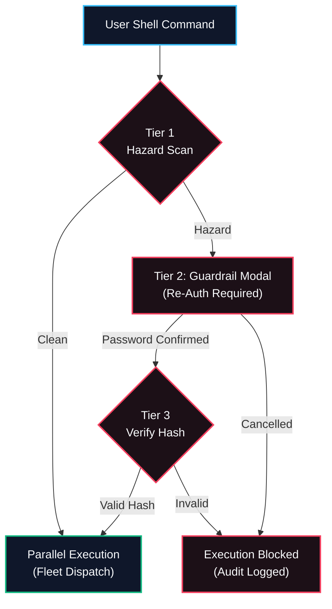

<div align="center">

# ⚡ CyberOps Command Center
### *Next-Gen Futuristic Web Workspace, Fleet Cluster Shell & Remote Service Orchestrator*

[](https://openjdk.org/)
[](https://spring.io/projects/spring-boot)
[](https://react.dev/)
[](https://www.typescriptlang.org/)
[](https://vitejs.dev/)
[](https://www.sqlite.org/)
[](https://www.docker.com/)
[](https://opensource.org/licenses/MIT)

<p align="center">
  <b>Connect to remote servers, cloud VPS instances, local machines, or Docker containers with zero keystroke latency, embedded encrypted storage, and deep automated service discovery.</b>
</p>

[🚀 Quick Start](#quick-start) • [✨ Core Features](#core-features) • [🏗️ Architecture](#system-architecture) • [🖥️ Remote Desktop (VNC)](#universal-remote-desktop-vnc-over-ssh) • [🛡️ Security](#security--safety-guardrails) • [📚 API Reference](#rest--websocket-api-reference)

---

</div>

## 🌟 Overview

**CyberOps Command Center** is a high-performance web-based DevOps workstation and server management cockpit. Built with a cyberpunk aesthetic and mission-critical engineering, it replaces scattered SSH windows, separate SFTP clients, external database tools, and third-party remote desktop viewers with a single, consolidated browser workspace.

```
┌──────────────────────────────────────────────────────────────────────────────────┐
│  0ms EXEC // Instant Command Bar  •  Persistent PTY  •  Fleet Broadcast Shell   │
│  Automated Service Probes         •  SQL/Redis Grid  •  Encrypted SFTP Browser   │
│  Cross-Platform VNC GUI Portal    •  AES-256 Vault   •  Destructive Guardrails   │
└──────────────────────────────────────────────────────────────────────────────────┘
```

---

<a id="core-features"></a><a id="-core-features"></a>
## ✨ Core Features

| Feature | Description |
| :--- | :--- |
| **⚡ 0ms Instant Command Bar** | Eliminates remote SSH keystroke latency via a local line buffer with command history (`↑`/`↓`) and batch execution. |
| **🚀 Cluster Broadcast Shell** | Parallel multi-server fleet execution with target filters (tags/groups), split matrix tiles, and consolidated table views. |
| **🛡️ 3-Tier Command Guardrails** | Intercepts high-risk destructive commands (e.g. `rm -rf`, `reboot`, `drop database`) with cryptographic re-authentication. |
| **🖥️ Universal Remote Desktop** | Native VNC-over-SSH streaming supporting **Linux** (XFCE/GNOME), **Windows** (TightVNC), **macOS** (native ARD & VNC), and **Android** (Termux). |
| **🔍 Non-Destructive Service Probe** | Automated deep inspection of sockets (`ss`/`netstat`), init daemons (`systemctl`/`OpenRC`), and Docker containers in ~70ms. |
| **📝 Interactive CLI Inspector** | Live previews of service CLI commands with contextual presets (e.g. `redis-cli`, `mysql`, `docker exec`) and on-the-fly editing. |
| **🗄️ Database Query Console** | Direct remote execution for MySQL, MariaDB, PostgreSQL, and Redis over SSH with formatted tabular grids. |
| **🔌 Secure Port Forwarding** | One-click local tunnel creation to bridge isolated remote ports (databases, APIs, internal dashboards) to `127.0.0.1`. |
| **📂 SFTP File Explorer** | Visual directory tree traversal, streaming upload/download, deletion, rename, and folder management. |
| **🔐 Embedded AES-256 Vault** | Embedded SQLite database (`cyberops.db`) with zero external database dependencies. Credentials encrypted with AES-256-GCM. |
| **🎛️ Cyber-Ops HUD & CRT Mode** | Futuristic telemetry HUD, real-time latency monitors, quick command palette (<kbd>Ctrl</kbd>+<kbd>K</kbd>), and toggleable CRT scanlines. |

---

<a id="system-architecture"></a><a id="-system-architecture"></a>
## 🏗️ System Architecture

```mermaid
flowchart TD
    %% Styling Themes
    classDef client fill:#0f172a,stroke:#38bdf8,stroke-width:2px,color:#f8fafc;
    classDef gateway fill:#090d16,stroke:#818cf8,stroke-width:2px,color:#f8fafc;
    classDef core fill:#0f172a,stroke:#10b981,stroke-width:2px,color:#f8fafc;
    classDef security fill:#1c1017,stroke:#f43f5e,stroke-width:2px,color:#f8fafc;
    classDef storage fill:#0f172a,stroke:#fbbf24,stroke-width:2px,color:#f8fafc;
    classDef remote fill:#090d16,stroke:#a855f7,stroke-width:2px,color:#f8fafc;

    subgraph CLIENT["🖥️ Browser Cockpit (React 18 + Vite)"]
        UI_DASH["Dashboard<br/>Servers & Tags"]:::client
        UI_TERM["Terminal Console<br/>xterm.js & 0ms Exec"]:::client
        UI_BCAST["Broadcast Console<br/>Multi-Server Shell"]:::client
        UI_SAFETY["Security Challenge<br/>Re-Auth Guardrail"]:::security
        UI_VNC["Remote Desktop<br/>NoVNC & ARD/VNC"]:::client
        UI_SVC["Service Orchestrator<br/>Probes & Logs"]:::client
        UI_DB["Database & Files<br/>SQL & SFTP Tree"]:::client
    end

    subgraph PROTOCOLS["⚡ Transport Layer"]
        HTTP_API["HTTPS / REST APIs<br/>Stateless JWT Auth"]:::gateway
        WS_TERM["WebSocket: /ws/terminal<br/>Full-Duplex PTY Stream"]:::gateway
        WS_VNC["WebSocket: /ws/desktop<br/>Binary RFB VNC Tunnel"]:::gateway
    end

    subgraph BACKEND["🛡️ Core Engine (Spring Boot 3 + MINA SSHD)"]
        AUTH_SVC["Security & JWT<br/>User Isolation"]:::core
        GUARD_SVC["CommandSafety<br/>7-Hazard Inspector"]:::security
        BCAST_SVC["BroadcastService<br/>Parallel Async Exec"]:::core
        TERM_HANDLER["TerminalHandler<br/>PTY Session Streamer"]:::core
        VNC_HANDLER["RemoteDesktopHandler<br/>DirectTcpip Bridge"]:::core
        SSH_MGR["SshSessionManager<br/>MINA Pool & Multiplex"]:::core
        SVC_PROBE["ServiceProbe<br/>~70ms Composite Probe"]:::core
        DB_TUNNEL["DB & Tunnels<br/>SQL Pipe & Port Forwards"]:::core
        SFTP_SVC["SftpService<br/>Streamed Transfers"]:::core
        VAULT["Credential Vault<br/>AES-256-GCM at Rest"]:::storage
    end

    subgraph STORAGE["💾 Persistence Layer"]
        SQLITE[("Embedded SQLite<br/>cyberops.db")]:::storage
    end

    subgraph FLEET["🌐 Target Infrastructure"]
        direction TB
        SSH_TARGETS["SSH Endpoints<br/>Ports: 22 • 5900-5903"]:::remote
        NODE_LINUX["🐧 Linux Servers<br/>Systemd • Docker • TigerVNC"]:::remote
        NODE_MAC["🍎 macOS Nodes<br/>Darwin PTY • Screen Sharing"]:::remote
        NODE_WIN["🪟 Windows Targets<br/>OpenSSH • TightVNC"]:::remote
        NODE_MOBILE["📱 Android / Termux<br/>OpenSSH • Termux X11"]:::remote

        SSH_TARGETS --- NODE_LINUX
        SSH_TARGETS --- NODE_MAC
        SSH_TARGETS --- NODE_WIN
        SSH_TARGETS --- NODE_MOBILE
    end

    %% Client to Transport
    UI_DASH -->|REST| HTTP_API
    UI_SVC -->|REST| HTTP_API
    UI_DB -->|REST| HTTP_API
    UI_BCAST -->|Broadcast| HTTP_API
    UI_BCAST -.->|Hazard Alert| UI_SAFETY
    UI_TERM <-->|PTY Stream| WS_TERM
    UI_VNC <-->|RFB Stream| WS_VNC

    %% Transport to Backend
    HTTP_API --> AUTH_SVC
    HTTP_API --> GUARD_SVC
    HTTP_API --> BCAST_SVC
    HTTP_API --> SVC_PROBE
    HTTP_API --> DB_TUNNEL
    HTTP_API --> SFTP_SVC
    WS_TERM <--> TERM_HANDLER
    WS_VNC <--> VNC_HANDLER

    %% Backend Internal Interactions
    GUARD_SVC -->|Verify| AUTH_SVC
    GUARD_SVC -->|Dispatch| BCAST_SVC
    BCAST_SVC --> SSH_MGR
    TERM_HANDLER <--> SSH_MGR
    VNC_HANDLER <--> SSH_MGR
    SVC_PROBE --> SSH_MGR
    DB_TUNNEL --> SSH_MGR
    SFTP_SVC --> SSH_MGR
    AUTH_SVC <--> VAULT
    SSH_MGR <--> VAULT
    VAULT <--> SQLITE

    %% Backend to Target Fleet
    SSH_MGR <-->|Interactive Shell| SSH_TARGETS
    SSH_MGR <-->|Port Forward 5900-5903| SSH_TARGETS
    SSH_MGR <-->|SFTP Subsystem| SSH_TARGETS
```



---

<a id="universal-remote-desktop-vnc-over-ssh"></a><a id="-universal-remote-desktop-vnc-over-ssh"></a>
## 🖥️ Universal Remote Desktop (VNC over SSH)

Access remote graphical desktops directly in your browser with **zero configuration**, **no open firewall ports**, and **no VPN required**. CyberOps tunnels the connection securely over your existing SSH session:

* **⚡ Auto-Hunting Port Scanner**: Automatically scans ports `5900`–`5903` over SSH, verifying RFB headers to eliminate ghost displays and invalid ports.
* **🍎 Native macOS Screen Sharing (ARD Support)**:
  - Supports Apple Remote Desktop (RFB Type 30) authentication using native macOS user account credentials.
  - Automatically switches to Standard VNC password mode if configured under macOS Computer Settings.
  - Smart OS detection ensures macOS-specific authentication prompts only appear when connecting to a Mac.
* **🐧 Linux Desktop Environments**: Connects instantly to headless XFCE, GNOME, or KDE sessions powered by TigerVNC or x11vnc.
* **🪟 Windows GUI**: Supports TightVNC or UltraVNC loopback tunneling.
* **📱 Mobile & Android**: Full support for Android devices running Linux via Termux X11.
* **⌨️ Virtual Keyboard & Controls**: Built-in on-screen keyboard with debounced input, fullscreen mode, and <kbd>Ctrl</kbd>+<kbd>Alt</kbd>+<kbd>Del</kbd> macros.

---

<a id="security--safety-guardrails"></a><a id="-security--safety-guardrails"></a>
## 🛡️ Security & Safety Guardrails

To prevent fleet-wide disasters and unauthorized tampering, commands pass through a **3-Tier Defense Engine**:



---

<a id="quick-start"></a><a id="-quick-start"></a>
## 🚀 Quick Start

### Prerequisites
* **Java 21+** & **Maven 3.8+**
* **Node.js 20+** & **npm**
* *(Optional)* **Docker & Docker Compose**

### 1-Click Startup

Clone the repository and run the launcher for your platform:

<table>
<tr>
<td><b>Linux / macOS</b></td>
<td>

```bash
chmod +x start.sh stop.sh
./start.sh
```
*(To stop: `./stop.sh`)*

</td>
</tr>
<tr>
<td><b>Windows (CMD / Double-Click)</b></td>
<td>

```cmd
start.bat
```
*(To stop: `stop.bat`)*

</td>
</tr>
<tr>
<td><b>Windows (PowerShell)</b></td>
<td>

```powershell
.\start.ps1
```
*(To stop: `.\stop.ps1`)*

</td>
</tr>
<tr>
<td><b>Docker Compose</b></td>
<td>

```bash
docker compose up -d
```
*(To stop: `docker compose down`)*

</td>
</tr>
</table>

The launcher automatically:
1. Validates runtime dependencies (Java 21+, Node 20+, Maven).
2. Cleans up ports `8080` & `5173`.
3. Boots the Spring Boot backend with embedded SQLite on `http://localhost:8080`.
4. Boots the React Cyber-Ops frontend on `http://localhost:5173`.
5. Opens your default browser ready to connect.

---

## 🔑 Default Credentials

| Service | Address | Default Email / Username | Default Password |
| :--- | :--- | :--- | :--- |
| **Web Dashboard** | `http://localhost:5173` | `admin@example.com` | `password123` |
| **Backend API** | `http://localhost:8080` | *Same as above* | *Same as above* |

> [!TIP]
> After logging in, you can add servers using either **Password** or **SSH Private Key** authentication. All credentials are encrypted immediately with AES-256-GCM.

---

## 💻 Managing Localhost / Local Machine

You can easily manage your own host computer using CyberOps:

1. **Verify SSH is active locally**:
   ```bash
   # Ubuntu / Debian
   sudo apt update && sudo apt install -y openssh-server && sudo systemctl enable --now ssh

   # Arch Linux
   sudo pacman -S openssh && sudo systemctl enable --now sshd

   # Fedora / RHEL
   sudo dnf install -y openssh-server && sudo systemctl enable --now sshd

   # macOS
   # System Settings -> General -> Sharing -> Enable 'Remote Login'
   ```
2. **Add Server Profile in CyberOps**:
   - **Profile Name**: `Localhost`
   - **Hostname**: `127.0.0.1`
   - **Port**: `22`
   - **Username**: Your computer's username (run `whoami` in terminal)
   - **Authentication**: `PASSWORD` or `KEY`
3. Click **Test Connection** &rarr; **Save Server Profile**.

---

<details>
<summary><b>📂 Repository Structure</b></summary>

```
CyberOps/
├── backend/
│   ├── src/main/java/com/cyberops/
│   │   ├── config/              # Security, SQLite dialect, WebMvc, WebSocket config
│   │   ├── controller/          # REST Controllers (Auth, Server, Broadcast, Service, DB, SFTP, Tunnels)
│   │   ├── dto/                 # Request/Response Data Transfer Objects
│   │   ├── model/               # JPA Entities (User, ServerProfile, Tunnel, AuditLog)
│   │   ├── repository/          # Spring Data JPA Repositories
│   │   ├── security/            # JWT Token Provider, Auth Filters, UserDetails
│   │   ├── service/             # SshClient, Broadcast, CommandSafety, ServiceManager, Database, Sftp
│   │   ├── websocket/           # Terminal & RemoteDesktop WebSocket Handlers
│   │   └── CyberOpsApplication.java
│   ├── src/main/resources/
│   │   ├── application.yml      # SQLite DB, JWT secret, logging config
│   │   └── db/migration/        # SQLite schema initialization
│   ├── pom.xml                  # Maven dependencies (Spring Boot 3, Apache MINA, SQLite)
│   └── cyberops.db              # Embedded SQLite database (auto-created)
├── frontend/
│   ├── src/
│   │   ├── api/                 # Axios client, Auth, Server, Broadcast, Service, SFTP endpoints
│   │   ├── components/
│   │   │   ├── auth/            # AuthModal (Login & Registration)
│   │   │   ├── broadcast/       # BroadcastWorkspace (Multi-exec shell, server picker, tiled output)
│   │   │   ├── common/          # SecurityChallengeModal, CyberPopup
│   │   │   ├── dashboard/       # ServerCard, ServerModal, Group/Tag Filters
│   │   │   ├── database/        # DatabaseConsoleModal (SQL & Redis query executor)
│   │   │   ├── desktop/         # RemoteDesktopModal, RemoteDesktopView, VncSetupGuideModal
│   │   │   ├── layout/          # Navbar, CyberHUD, CommandPalette (Ctrl+K)
│   │   │   ├── monitoring/      # MonitoringModal (CPU, Memory, Uptime metrics)
│   │   │   ├── services/        # ServiceManagerModal (Probe, CLI Inspector/Editor, Logs)
│   │   │   ├── sftp/            # FileManagerModal (Directory tree, upload/download)
│   │   │   ├── terminal/        # TerminalWorkspace, TerminalView (xterm.js + 0ms Bar)
│   │   │   └── tunnels/         # TunnelManagerModal (Port forward bridge)
│   │   ├── types/               # TypeScript interfaces (ServerProfile, Broadcast, Safety, etc.)
│   │   ├── App.tsx              # Root router & persistent tab orchestrator
│   │   └── index.css            # Cyber-Ops design tokens, animations, CRT scanlines
│   ├── package.json             # React 18, Vite, Lucide Icons, xterm.js, NoVNC
│   └── vite.config.ts
├── start.sh / stop.sh           # Unix startup and shutdown scripts
├── start.bat / stop.bat         # Windows CMD startup and shutdown scripts
├── start.ps1 / stop.ps1         # Windows PowerShell startup and shutdown scripts
└── docker-compose.yml           # Unified production container orchestration
```

</details>

---

<details>
<summary><b>⚙️ Configuration & Environment Variables</b></summary>

| Variable | Default Value | Description |
|:---|:---|:---|
| `SERVER_PORT` | `8080` | Backend HTTP & WebSocket port |
| `SPRING_DATASOURCE_URL` | `jdbc:sqlite:cyberops.db` | SQLite JDBC connection string |
| `JWT_SECRET` | `S3cur3Cyb3rOpsJwTS3cr3tK3y2026!@#$` | Secret key used for signing JWT tokens |
| `JWT_EXPIRATION_MS` | `86400000` (24h) | JWT session validity duration in milliseconds |
| `APP_MASTER_KEY` | `CyberOpsMasterEncKey202632B!` | 32-byte AES key for encrypting credentials at rest |
| `SSH_CONNECT_TIMEOUT_MS` | `30000` (30s) | SSH connection and authentication timeout in milliseconds |
| `SSH_CHANNEL_TIMEOUT_MS` | `30000` (30s) | SSH PTY/Shell channel open verification timeout in milliseconds |
| `SSH_EXEC_TIMEOUT_MS` | `30000` (30s) | Timeout for remote diagnostic & service execution commands |
| `SSH_HEARTBEAT_INTERVAL_MS` | `15000` (15s) | Heartbeat keep-alive interval for cellular, VPN, and Tailscale links |

</details>

---

<a id="rest--websocket-api-reference"></a><a id="api-reference"></a>
<details>
<summary><b>📡 REST & WebSocket API Reference</b></summary>

### Authentication
* `POST /api/auth/register` — Register a new workspace operator
* `POST /api/auth/login` — Authenticate and retrieve JWT bearer token
* `POST /api/auth/logout` — Invalidate user session

### Server Fleet Management
* `GET /api/servers` — List all registered server profiles
* `POST /api/servers` — Create server profile (AES-256-GCM encrypted credentials)
* `GET /api/servers/{id}` — Fetch server profile details
* `PUT /api/servers/{id}` — Update server profile configuration
* `DELETE /api/servers/{id}` — Remove profile and cleanly sever active sessions
* `POST /api/servers/{id}/test` — Measure SSH round-trip latency & connectivity
* `POST /api/servers/{id}/connect` — Instantiate authenticated SSH session

### Service Orchestrator
* `GET /api/servers/{id}/services` — Discover listening ports, system daemons & containers
* `POST /api/servers/{id}/services/action` — Trigger lifecycle actions (`START`, `STOP`, `RESTART`, `RELOAD`)
* `GET /api/servers/{id}/services/{name}/logs` — Stream real-time logs from `journalctl`, `docker logs`, or system log files

### Cluster Broadcast & Fleet Multi-Exec
* `POST /api/cluster/broadcast` — Parallel non-blocking execution across targeted servers with guardrails & re-auth

### Remote Desktop & Terminals
* `WSS /ws/terminal/{sessionId}` — Full-duplex JSON stream (`INPUT`, `OUTPUT`, `RESIZE`, `STATUS`)
* `WSS /ws/desktop/{sessionId}` — Binary VNC/RFB WebSocket stream over SSH direct-tcpip channel

### Database & Service Tunnels
* `POST /api/servers/{id}/database/query` — Execute SQL/Redis query over SSH channel
* `GET /api/servers/{id}/tunnels` — List port forwarding configurations
* `POST /api/servers/{id}/tunnels` — Create local port forward bridge

### SFTP File Management
* `GET /api/servers/{id}/files` — List remote directory tree
* `POST /api/servers/{id}/files/upload` — Stream file upload to remote destination
* `GET /api/servers/{id}/files/download` — Stream download from remote path
* `DELETE /api/servers/{id}/files` — Delete remote file or folder
* `POST /api/servers/{id}/files/mkdir` — Create new remote directory
* `PUT /api/servers/{id}/files/rename` — Move or rename remote file

</details>

---

## 📜 License

This project is licensed under the **MIT License**.

<div align="center">
  <sub>Engineered with ⚡ for high-velocity DevOps, SysAdmins, and Security Operators.</sub>
</div>
